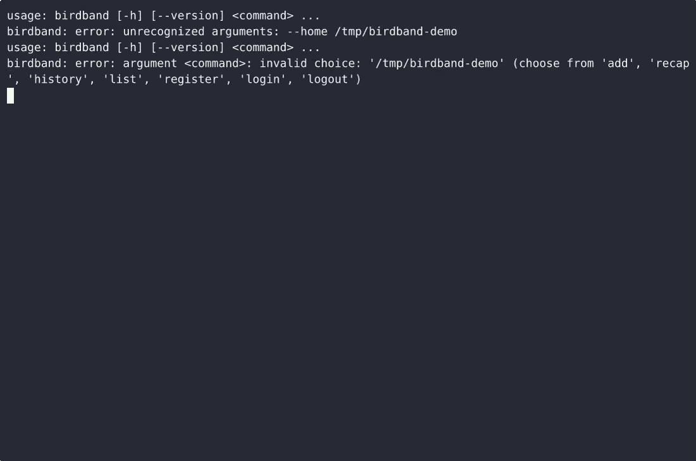
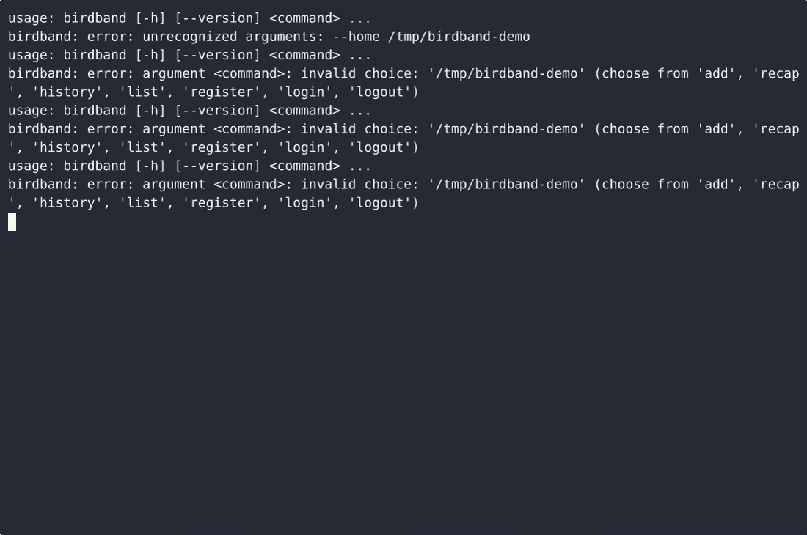

# BirdBand — complete Full-stack app command-line tool example app

A Full-stack app command-line tool, open-source and ready to self-host: that's **BirdBand**. BirdBand is a single-file, standard-library-only Python command-line tool for bird banders: it saves a banding record per bird (band number, species, date, site, wing chord in mm and weight in g), logs recaptures of a…. BirdBand ships complete — source, design assets, seed data — under the Apache-2.0 license; no cloud account needed. [Remix BirdBand on cenius.ai](https://cenius.ai/marketplace/p/birdband?ref=gh&utm_campaign=birdband-webapp) for a custom build.


[](LICENSE)  [](https://cenius.ai)

[](https://cenius.ai/marketplace/p/birdband?ref=gh&utm_campaign=birdband-webapp)

> **▶ [Open & edit in cenius.ai](https://cenius.ai/marketplace/p/birdband?ref=gh&utm_campaign=birdband-webapp)** — one click to an editable workspace: describe changes in plain English, get an instant preview, one-click deploy and host. Modifications made on the platform come with full rebrand & relicense rights.

_Local clone? See [Quick start](#quick-start) below. cenius.ai is the zero-setup path._

## Demo


▶ **[Watch the full demo video](https://cenius.ai/marketplace/p/birdband?ref=gh&utm_campaign=birdband-webapp)** — the complete walkthrough, playing on the project's cenius.ai page · [MP4 file](.github/media/demo.mp4)

## Screenshots

 

## Features

- Banding record keeper
- Wing chord and weight log
- Recapture history tracker

## Architecture

`install.sh` takes care of packages and initial data in a single pass; nothing else is required before launching. The Full-stack app codebase (13 files) is self-contained — no external services needed to evaluate it. Top-level layout: `tests/`. See [`INSTALL.md`](INSTALL.md) for complete setup instructions.

## Quick start

```bash
./install.sh   # installs dependencies + seeds demo data
```

See [`INSTALL.md`](INSTALL.md) for full setup and usage instructions.

## Usage guide

Every example below assumes you are in the project root. `birdband` in the
examples means `python3 birdband.py` (or just `birdband` after
`pip install -e .`).

### Before the session: create your account and sign in

Records carry the name of the bander who saved them, so the two write commands
need a bander to sign in as. The passphrase is entered twice, hidden, and stored
as a salted PBKDF2-HMAC-SHA256 hash - never as text.

```console
$ birdband register Dana
passphrase for Dana:
repeat passphrase:
account created for Dana

$ birdband login Dana          # you can leave the name off if you have one account
passphrase for Dana:
signed in as Dana - session expires 2025-04-01T21:10:07+00:00
```

The session lasts 12 hours. `birdband logout` deletes it; until then, `add` and
`recap` run without a prompt, and `list` and `history` never need a sign-in at
all.

Wrong passphrase, unknown bander - same answer, so the tool never tells an
outsider which half was wrong:

```console
$ birdband login Dana
passphrase for Dana:
username or passphrase not recognised
```

### Logging a bird at the moment of banding

Band, date and site are required; the rest is whatever you actually measured.
Wing chord and weight are independent - take one, both or neither.

```console
$ birdband add --band 2621-48357 --date 2025-04-01 --site "Ridge Trail" \
      --species "Black-capped Chickadee" --age AHY --sex F --wing 62 --weight 11.4
banded 2621-48357 on 2025-04-01 at Ridge Trail  Black-capped Chickadee - wing 62 mm, weight 11.4 g, bander Dana

_Full guide: [`USAGE.md`](USAGE.md)_

## FAQ

### How do I self-host BirdBand?

Everything you need ships in this repo: clone it, run `./install.sh` to install dependencies and seed demo data, then follow [`INSTALL.md`](INSTALL.md) to start it. No external services required.

### Can I rebrand or white-label BirdBand?

Yes — and the easiest way is [remixing it on cenius.ai](https://cenius.ai/marketplace/p/birdband?ref=gh&utm_campaign=birdband-webapp): modifications made on the platform come with full rebrand and relicense rights over your derivative.

### What technologies are in BirdBand's stack?

Full-stack app. The full source in this repository is exactly what the app runs. Highlights include banding record keeper.

### How can I customize BirdBand without editing code?

Open it on [cenius.ai](https://cenius.ai/marketplace/p/birdband?ref=gh&utm_campaign=birdband-webapp) and describe the changes you want in plain English — the platform modifies the app and gives you a new, downloadable build.

### Is it OK to ship BirdBand as part of a product?

Yes. The code is Apache-2.0-licensed — use it, modify it, and ship it commercially. See [LICENSE](LICENSE).

## License & rebranding

Released under the [Apache License 2.0](LICENSE) (© 2026 Cenius AI) — free for personal and commercial use. The Cenius name/logo are trademarks (see NOTICE).

**Need a customized version?** [Remix this app on cenius.ai](https://cenius.ai/marketplace/p/birdband?ref=gh&utm_campaign=birdband-webapp) — modifications made on the platform come with **full rebrand & relicense rights** over your derivative.

## Built with cenius.ai

This entire application — code, design, seeded demo data — was generated on **[cenius.ai](https://cenius.ai)** from a plain-English description.

- 🚀 [Build your own app on cenius.ai](https://cenius.ai)
- 🎛️ [Remix BirdBand on the marketplace](https://cenius.ai/marketplace/p/birdband?ref=gh&utm_campaign=birdband-webapp) — open it in a workspace, prompt for changes, and ship your own version.

More open-source apps: [the Cenius-ai catalog](https://github.com/Cenius-ai) · [showcase index](https://github.com/Cenius-ai/showcase)
